 

 

 

## Engineering rules

| Rule | In practice |
|---|---|
| Fail closed | A fault or an invalid reading puts the service in a safe state. It never guesses. |
| Idempotent writes | Every write carries a key, so a retry cannot repeat a physical action. |
| Expand, then contract | Migrations stay compatible with the previous binary. |
| Red test first | Shared records get a deterministic interleaving test, and each guard is sabotaged to prove it fails. |

## Selected work

| Project | What it is | Stack |
|---|---|---|
| [Memorys](https://github.com/LeandroPG19/Memorys) | Persistent memory MCP server for AI agents: knowledge graph, episodic memory, contradiction detection and Bayesian calibration. Open source. |  |
| Industrial MES platform | Manufacturing execution backend for the plant floor: Rust services, PostgreSQL as the source of truth. Private. |  |
| CNC tooling | Parametric CNC simulator and CAM tooling for machine shops. Private. |  |

<picture>
  <source media="(prefers-color-scheme: dark)" srcset="https://raw.githubusercontent.com/LeandroPG19/LeandroPG19/output/snake.svg" />
  <source media="(prefers-color-scheme: light)" srcset="https://raw.githubusercontent.com/LeandroPG19/LeandroPG19/output/snake-light.svg" />
  
</picture>

  

